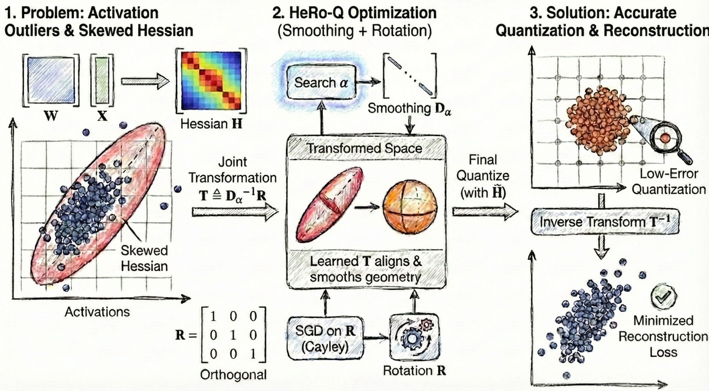

# HeRO-Q

> Figure 1: Robust Quantization via Hessian Transformation: HeRo-Q first analyzes the Hessian structure and identifies a severe Hessian geometric skewness —certain directions exhibit extremely high curvature (corresponding to large eigenvalues) and are highly sensitive to quantization noise. To address this, HeRo-Q searches over smoothing parameters $\alpha$ to construct a diagonal scaling matrix $\mathbf{D}_\alpha$, and learns an orthogonal rotation matrix $\mathbf{R}$ via the Cayley transform. Together, they form a linear transformation $\mathbf{T} = \mathbf{D}_\alpha^{-1} \mathbf{R}$ that maps the original weight space into a geometrically more balanced transformed space. Robust quantization is then performed in this transformed space, and the quantized weights in the original space are recovered through the inverse transformation.

To ensure reproducibility and rigorous performance evaluation, all experiments presented in the paper were conducted in a high-performance computing environment.

### Hardware Environment
* **GPU:** The main experiments, including Perplexity (PPL) evaluation and Downstream Task benchmarks, were performed on a server equipped with **8 $\times$ NVIDIA A800 GPUs**.
* **Latency Benchmarking:** As detailed in the paper (Appendix A.5), inference latency and throughput measurements were conducted on a single NVIDIA A800 GPU to assess the real-world efficiency of the CALM framework compared to uniform quantization baselines like GPTQ.

### Software Environment
* **CUDA Version:** [Insert your CUDA version, 12.8]
* **PyTorch Version:** [Insert your PyTorch version, 2.1.2]
* **Dependencies:** Please refer to `environment.yml` for the complete list of libraries.
* 

> Figure 2: Overview of the HeRo-Q Inference Pipeline.We adopt a hybrid deployment strategy for the transformation $\mathbf{T} \triangleq \mathbf{D}_{\alpha}^{-1}\mathbf{R}$. Purple blocks denote mergeable transformations, where $\mathbf{T}$ or $\mathbf{T}^{-1}$ is fused offline into the adjacent weights ($\mathbf{W}_{q,k,v,o}$ and MLP weights), incurring zero runtime overhead. Grey blocks indicate \textit{online transformations} required where structural fusion is blocked (before RoPE or for KV-cache quantization), which are executed efficiently using optimized kernels.
